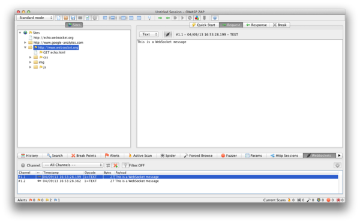
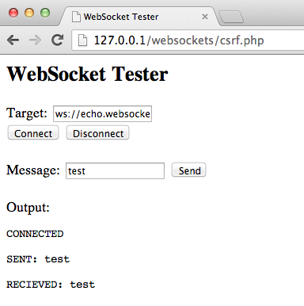

# WebSockets

|ID          |
|------------|
|WSTG-CLNT-10|

## Summary

Traditionally, the HTTP protocol only allows one request/response per TCP connection. Asynchronous JavaScript and XML (AJAX) allows clients to send and receive data asynchronously (in the background without a page refresh) to the server, however, AJAX requires the client to initiate the requests and wait for the server responses (half-duplex).

[WebSockets](https://websockets.spec.whatwg.org/#network-intro) allow the client or server to create a 'full-duplex' (two-way) communication channel, allowing the client and server to truly communicate asynchronously. WebSockets conduct their initial *upgrade* handshake over HTTP and from then on all communication is carried out over TCP channels by use of frames. For more, see the [WebSocket Protocol](https://tools.ietf.org/html/rfc6455).

### Origin

It is the server’s responsibility to verify the [`Origin` header](https://developer.mozilla.org/en-US/docs/Web/HTTP/Reference/Headers/Origin) in the initial HTTP WebSocket handshake. If the server does not validate the origin header in the initial WebSocket handshake, the WebSocket server may accept connections from any origin. This could allow attackers to communicate with the WebSocket server cross-domain allowing for CSRF-like issues. See also [A01:2025 Broken Access Control](https://owasp.org/Top10/2025/A01_2025-Broken_Access_Control/). The exploit for this weakness is called Cross-Site Websocket Hijacking (CSWH or CSWSH).

### Confidentiality and Integrity

WebSockets can be used over unencrypted TCP or over encrypted TLS. To use unencrypted WebSockets the `ws://` URI scheme is used (default port 80), to use encrypted (TLS) WebSockets the `wss://` URI scheme is used (default port 443). See also [A04:2025 Cryptographic Failures](https://owasp.org/Top10/2025/A04_2025-Cryptographic_Failures/).

### Input Sanitization

As with any data originating from untrusted sources, the data should be properly sanitized and encoded. See also [A05:2025 Injection](https://owasp.org/Top10/2025/A05_2025-Injection/) (includes XSS).

## Test Objectives

- Identify the usage of WebSockets.
- Assess its implementation by using the same tests on normal HTTP channels.
- Verify that authentication and authorization are enforced for the handshake and for every subsequent frame, subscription, and pushed event.
- Verify that Origin allowlisting uses exact scheme, host, and port comparison.

## How to Test

### Black-Box Testing

1. Identify that the application is using WebSockets.
   - Inspect the client-side source code for the `ws://` or `wss://` URI scheme.
   - Use Google Chrome's Developer Tools to view the Network WebSocket communication.
   - Use [ZAP's](https://www.zaproxy.org) WebSocket tab.
2. Origin.
   - Using a WebSocket client (one can be found in the Tools section below) attempt to connect to the remote WebSocket server. If a connection is established the server may not be checking the origin header of the WebSocket handshake.
   - Treat Origin checks as a parser problem, not only a presence check. With a controlled DNS name, try the exact allowed origin, a malicious suffix (`allowed.example.attacker.test`), a trailing dot, an unexpected port, mixed case, an IDNA/punycode twin, and scheme mismatches (`http` versus `https`). The server must compare a parsed scheme, host, and port, not a substring or loose regular expression.
3. Confidentiality and Integrity.
   - Check that the WebSocket connection is using TLS to transport sensitive information `wss://`.
   - Check the HTTPS Implementation for security issues (Valid Certificate, BEAST, CRIME, RC4, etc). Refer to the [Weak Transport Layer Security](../09-Weak_Cryptography/01-Weak_Transport_Layer_Security.md) section of this guide.
4. Authentication.
   - WebSockets do not handle authentication, normal black-box authentication tests should be carried out. Refer to the [Authentication Testing](../04-Authentication/README.md) sections of this guide.
   - If the handshake carries a token in the URL, query string, or first message, confirm it is not logged by intermediaries and that it expires with the HTTP session.
5. Authorization.
   - WebSockets do not handle authorization by themselves. Apply the [Authorization Testing](../05-Authorization/README.md) tests to the handshake **and** to individual frames. A successful low-privilege connection must not imply access to every topic, room, tenant, or object on that socket.
6. Per-Message and Subscription Authorization.
   - Connect with two tester-owned accounts that have different roles or object membership.
   - Capture a legitimate subscribe, join, listen, or GraphQL subscription frame from account A.
   - Replay it on account B's connection after substituting user, session, room, channel, tenant, conversation, or object identifiers.
   - Confirm both the immediate response and later pushed events. Authorization that filters only the first snapshot but continues to broadcast unauthorized events is a finding.
   - After logout, password change, role removal, or token expiry on one device, verify that the still-open socket stops accepting privileged frames and stops receiving private events. Reconnect with the revoked credential and confirm the handshake or first authenticated frame is denied.
   - If the application also exposes HTTP or long-poll fallbacks for the same events, compare authorization decisions across transports.
7. Input Sanitization.
   - Use [ZAP's](https://www.zaproxy.org) WebSocket tab to replay and fuzz WebSocket requests and responses. Refer to the [Injection Testing](../07-Injection/README.md) section of this guide.

#### Example: Per-Message Authorization

Suppose account A belongs to conversation `c_a` and account B belongs to conversation `c_b`. After both accounts open authenticated sockets, capture A's subscribe frame:

```json
{"type":"subscribe","channel":"conversation","id":"c_a"}
```

On B's socket, send the same frame with `"id":"c_a"`. Secure behavior denies the subscribe and never pushes A's messages. Insecure behavior returns the history for `c_a`, or later emits events for `c_a` on B's connection.

Repeat after B logs out while the socket stays open. Privileged frames and private push events must stop.

#### Example 1

Once we have identified that the application is using WebSockets (as described above) we can use the [Zed Attack Proxy (ZAP)](https://www.zaproxy.org) to intercept the WebSocket request and responses. ZAP can then be used to replay and fuzz the WebSocket request/responses.

\
*Figure 4.11.10-1: ZAP WebSockets*

#### Example 2

Using a WebSocket client (one can be found in the Tools section below) attempt to connect to the remote WebSocket server. If the connection is allowed the WebSocket server may not be checking the WebSocket handshake's origin header. Attempt to replay requests previously intercepted to verify that cross-domain WebSocket communication is possible.

\
*Figure 4.11.10-2: WebSocket Client*

### Gray-Box Testing

Gray-box testing is similar to black-box testing. In gray-box testing, the pentester has partial knowledge of the application. The only difference here is that you may have API documentation for the application being tested which includes the expected WebSocket request and responses.

## Tools

- [Zed Attack Proxy (ZAP)](https://www.zaproxy.org)
- [WebSocket Client](https://github.com/ethicalhack3r/scripts/blob/master/WebSockets.html)

## References

- [HTML5 Rocks - Introducing WebSockets: Bringing Sockets to the Web](https://web.dev/articles/websockets-basics)
- [WHATWG - WebSockets Standard](https://websockets.spec.whatwg.org/#network-intro)
- [IETF - The WebSocket Protocol](https://tools.ietf.org/html/rfc6455)
- [CWE-1385: Missing Origin Validation in WebSockets](https://cwe.mitre.org/data/definitions/1385.html)
- [Christian Schneider - Cross-Site WebSocket Hijacking (CSWSH)](https://www.christian-schneider.net/blog/cross-site-websocket-hijacking/)
- [Robert Koch- On WebSockets in Penetration Testing](https://repositum.tuwien.at/retrieve/21955)
- [DigiNinja - ZAP and Web Sockets](https://digi.ninja/blog/zap_web_sockets.php)
