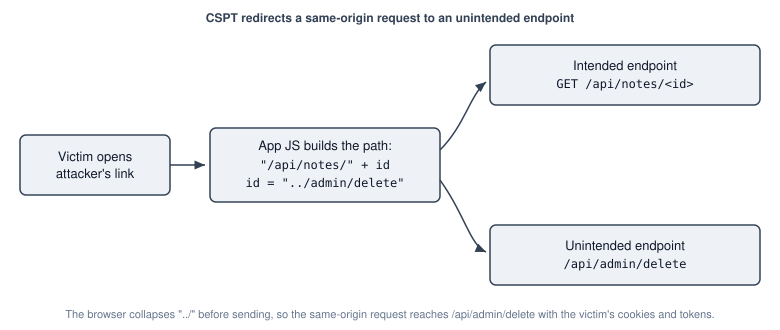

# Client-side Path Traversal

|ID          |
|------------|
|WSTG-CLNT-19|

## Summary

Client-side Path Traversal (CSPT) occurs when client-side code places attacker-controlled input into the path of a request that the application itself sends, usually with `fetch` or `XMLHttpRequest`. By injecting `../` sequences, an attacker makes the victim's browser send an authenticated same-origin request to an endpoint the application never intended to call.

Unlike server-side path traversal, which reads files from the server's file system, CSPT redirects a request the front end was already going to make. Because the request is issued by the application's own JavaScript, the browser attaches the victim's cookies, and the application adds any headers it normally sends, including bearer tokens and anti-CSRF tokens. As a result, CSPT can be used to reach state-changing endpoints even when the application relies on `SameSite` cookies or CSRF tokens, an attack known as CSPT2CSRF. If the redirected request returns attacker-influenced data that the page then renders or executes, CSPT can also lead to Cross Site Scripting (CSPT2XSS).

A useful way to frame the vulnerability is as a source and a sink:

- The source is the input that reaches the request path: a path segment, a query-string parameter, the URL fragment, or a value previously stored by the application.
- The sink is the request the traversal reaches. The method, headers, and body are fixed by the code that builds the request. When the input only changes the path, the request stays on the legitimate origin. When the application resolves the input as a URL, the host can change too, as described below.

The following figure shows the basic flow.

\
*Figure 4.11.19-1: A client-side path traversal redirecting a same-origin request to an unintended endpoint*

## Test Objectives

- Identify inputs that reach the path of a client-side request.
- Determine which unintended endpoints, methods, and actions those inputs can reach.
- Assess the impact, including bypass of anti-CSRF defenses and escalation to Cross Site Scripting.

## How to Test

Test only against applications you own or are authorized to assess. Use tester-owned accounts and benign canary endpoints, and do not perform state-changing actions against data belonging to other users.

### Identify Sources

Review the client-side code and traffic for places where input is concatenated into a request path. Typical sources are:

- Path segments, for example a note or object identifier taken from the page URL.
- Query-string parameters read with `URLSearchParams` or a router.
- The URL fragment (`#...`), which is a DOM-based source that the server never sees in logs.
- Values read back from an API that were originally attacker-controlled, which makes the source stored rather than reflected.

In the code, follow each source to a sink such as `fetch`, `XMLHttpRequest`, `axios`, or a framework HTTP client, and note whether the value is passed through `encodeURIComponent` or validated before it reaches the path. Encoding alone is not enough: `encodeURIComponent` leaves a value of exactly `..` unchanged, so such code is still worth testing with `..` as the whole value.

### Confirm the Traversal

With an intercepting proxy or the browser developer tools, submit a value that walks up out of the intended path and into a benign endpoint, then confirm which request actually left the browser. For example, where the application requests `/api/notes/<id>`, set the identifier to `../profile` and verify that the browser sends `GET /api/profile`.

How the input is encoded decides whether the traversal happens in the browser or only at the server. The browser normalizes the request URL before sending it, and the following behavior can be confirmed by observing the request that reaches the server:

- Literal `../` is collapsed by the browser, so the traversed request is what leaves the browser. A backslash (`..\`) behaves the same way, because browsers treat it as a path separator.
- Percent-encoded dots with a literal separator, such as `%2e%2e/`, are also collapsed, because the browser decodes `%2e` to `.` before normalizing the path.
- A percent-encoded separator, such as `%2f` or `%5c`, is not decoded by the browser and is sent literally. Such a payload only traverses if the server or framework later decodes and normalizes it, so test it against the back end rather than assuming a client-side effect.
- When the value walks downward first, the dot-segment arithmetic still applies: `foo/../profile` sent to `/api/notes/<id>` resolves to `/api/notes/profile`.

The way the request URL is built also matters. When the path is assembled by string concatenation, a leading `/` in the input is just another path segment and does not escape the base. When the application builds the URL with `new URL(id, base)` and the input is the relative reference, a leading `/` produces a host-absolute path and gives the attacker full control of the path, and a value that starts with `//`, such as `//attacker.example/x`, changes the host as well. The request then goes to the attacker's server with any headers the application adds, such as a bearer token. Identify which pattern the application uses.

### Assess the Sink and Impact

The HTTP method is fixed by the calling code, so a `GET` source can only reach `GET` sinks directly, and a source on a `POST`, `PUT`, `PATCH`, or `DELETE` request can reach sinks of that method. Map the endpoints reachable under each method and consider the impact:

- A state-changing sink (`POST`, `PUT`, `PATCH`, or `DELETE`) reached this way is a CSRF that bypasses `SameSite` and token defenses, because the application sends the request with its own credentials and headers.
- A `GET` sink is lower impact on its own, but it can be escalated. If the redirected request returns data that the page renders without sanitization, the result is Cross Site Scripting. If the response is used to build a later request, a `GET` source can be chained to a state-changing one, for example by first pointing the traversal at an uploaded file whose contents steer a second request.

Because the back end often accepts extra or unexpected fields, a sink may act even when the request body is fixed by the calling code. Test whether the reachable endpoint ignores the irrelevant body it receives.

## Related Test Cases

- [DOM-Based Cross Site Scripting](01-DOM-based_Cross_Site_Scripting.md)
- [Cross Site Request Forgery](../06-Session_Management/05-Cross_Site_Request_Forgery.md)
- [Directory Traversal and File Include](../05-Authorization/01-Directory_Traversal_File_Include.md)
- [Client-side URL Redirect](04-Client-side_URL_Redirect.md)

## Remediation

- Do not place untrusted input into a request path. Where an identifier must be used, validate it against an allow list or a strict pattern, such as digits only. Encoding the value with `encodeURIComponent` stops `/` and `\` from adding path segments, but it leaves `.` and `..` unchanged, so a value of `..` still moves the request up one level. Validation is what prevents that.
- Prefer passing identifiers as query-string or body parameters that the client sends through a fixed, server-defined path.
- On the server, enforce a strict schema for each endpoint so that requests carrying unexpected parameters or shapes are rejected rather than acted upon.
- Be aware that generated API clients often insert string parameters into the path without traversal checks, so apply the same validation in that client code.

## Tools

- [Burp Suite](https://portswigger.net/burp)
- [ZAP](https://www.zaproxy.org)
- [CSPT Burp Extension](https://github.com/doyensec/CSPTBurpExtension)

## References

- [Doyensec: Exploiting Client-Side Path Traversal to Perform Cross-Site Request Forgery](https://blog.doyensec.com/2024/07/02/cspt2csrf.html)
- [Doyensec: CSPT2CSRF Whitepaper](https://www.doyensec.com/resources/Doyensec_CSPT2CSRF_Whitepaper.pdf)
- [Doyensec: CSPT Resources](https://blog.doyensec.com/2025/03/27/cspt-resources.html)
- [PortSwigger: On-site Request Forgery](https://portswigger.net/blog/on-site-request-forgery)
- [OWASP Cheat Sheet Series: Cross-Site Request Forgery Prevention](https://cheatsheetseries.owasp.org/cheatsheets/Cross-Site_Request_Forgery_Prevention_Cheat_Sheet.html)
